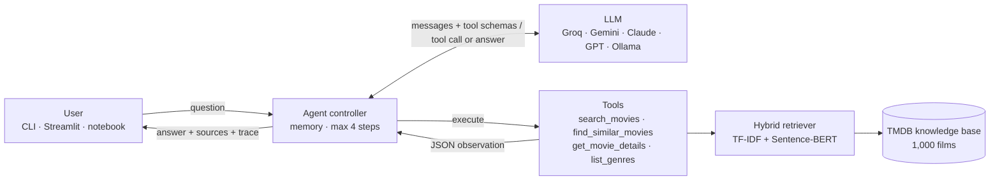

# Applied AI: Vision, NLP & LLM Agents


Three end-to-end AI projects built for the **CN6005 Artificial Intelligence** module (University of East London, 2026/27): a computer-vision classifier for recycling, unsupervised topic discovery in news, and a tool-using LLM agent with a web UI.

| # | Project | Techniques | Notebook |
|---|---|---|---|
| 1 | **Waste image classification** — sort household waste photos into 6 recycling classes | ANN vs CNN (Keras), overfitting study, augmentation, class weights, MobileNetV2 transfer learning, Grad-CAM explainability | [Task1_ImageClassification.ipynb](Task1_ImageClassification.ipynb) |
| 2 | **Topic discovery in BBC News** — cluster 2,000+ articles without labels | NLTK pipeline, TF-IDF, K-Means (Elbow + Silhouette), Sentence-BERT (MiniLM & MPNet), internal **and** external cluster validation, t-SNE | [Task2_TextMining.ipynb](Task2_TextMining.ipynb) |
| 3 | **CineGuide movie agent** — recommends films from a 1,000-film knowledge base | LLM function-calling (ReAct loop), hybrid TF-IDF + SBERT retrieval, conversation memory, provider-agnostic LLM client, Streamlit UI, unit tests + CI | [Task3_AIAgent.ipynb](Task3_AIAgent.ipynb) · [`movie_agent/`](movie_agent/) |

## Results

<!-- Fill in after running the notebooks (numbers are printed in each notebook's summary cell). -->

| Task 1 — test set | Accuracy | Macro F1 | Macro ROC-AUC | Parameters |
|---|---|---|---|---|
| ANN | _TBD_ | _TBD_ | _TBD_ | 12.6 M |
| CNN (regularised) | _TBD_ | _TBD_ | _TBD_ | 1.2 M |
| MobileNetV2 (transfer learning) | _TBD_ | _TBD_ | _TBD_ | 2.3 M |

| Task 2 — K-Means, K chosen by silhouette | ARI | NMI | Purity | Silhouette |
|---|---|---|---|---|
| TF-IDF | _TBD_ | _TBD_ | _TBD_ | _TBD_ |
| Sentence-BERT MiniLM | _TBD_ | _TBD_ | _TBD_ | _TBD_ |
| Sentence-BERT MPNet | _TBD_ | _TBD_ | _TBD_ | _TBD_ |

| Task 3 — agent | Value |
|---|---|
| Retrieval Hit@5 (hybrid, 20 queries) | _TBD_ |
| Scenario tests passed | _TBD_ / 7 |
| Groundedness (recommended titles found in tool results) | _TBD_ |

## Highlights

- **Honest evaluation.** Task 1 includes a deliberately un-regularised baseline CNN to *show* overfitting before fixing it; Task 2 scores clusters against hidden editorial labels (ARI/NMI/purity) because internal metrics are not comparable across feature spaces; Task 3 measures retrieval (Hit@k, MRR), tool choice, filter compliance and hallucination.
- **Explainability.** Grad-CAM heat-maps show the CNN looks at the object, not the background; every agent answer comes with its tool trace and source films.
- **Engineering.** The agent is a small, typed Python package with offline unit tests (a scripted fake LLM drives the tool loop), GitHub Actions CI, graceful degradation without an API key, and one client for Groq, Gemini, Claude, OpenAI or a local Ollama model.

## CineGuide architecture



## Quick start

```bash
git clone https://github.com/donpayagala/CN6005-Applied-AI.git
cd CN6005-Applied-AI
python -m venv .venv && source .venv/bin/activate     # Windows: .venv\Scripts\activate
pip install -r requirements.txt
jupyter notebook
```

- **Datasets** download automatically through `kagglehub` (needs a free Kaggle account and API token — see `datasets/links.txt`).
- **GPU** recommended for Task 1 and Task 2's transformer step — each notebook has an *Open in Colab* button.
- **LLM key (Task 3):** copy `.env.example` to `.env` and add a free [Groq](https://console.groq.com/keys) or [Gemini](https://aistudio.google.com/apikey) key. Without a key the agent runs in retrieval-only mode.

Chat with the agent:

```bash
streamlit run app.py        # web UI
python -m movie_agent       # terminal
pytest -q                   # offline unit tests
```

## Repository structure

```
├── Task1_ImageClassification.ipynb   ANN vs CNN vs MobileNetV2 on waste images
├── Task2_TextMining.ipynb            TF-IDF vs Sentence-BERT clustering of BBC News
├── Task3_AIAgent.ipynb               CineGuide design, demo and evaluation
├── movie_agent/                      agent package (data, retriever, tools, llm, agent, evaluation)
├── app.py                            Streamlit chat UI
├── tests/                            offline unit tests (pytest)
├── datasets/links.txt                dataset sources
├── screenshots/                      every figure, saved automatically by the notebooks
├── requirements.txt                  all libraries
├── README.txt                        run instructions (submission format)
└── .github/workflows/tests.yml       CI
```

## Datasets

- [Garbage Classification](https://www.kaggle.com/datasets/asdasdasasdas/garbage-classification) — 6 classes, ~2.5k images (TrashNet, Yang & Thung 2016)
- [BBC Full Text Document Classification](https://www.kaggle.com/datasets/shivamkushwaha/bbc-full-text-document-classification) — 2,225 articles, 5 sections (Greene & Cunningham 2006)
- [TMDB 5000 Movie Dataset](https://www.kaggle.com/datasets/tmdb/tmdb-movie-metadata) — movie metadata and credits
